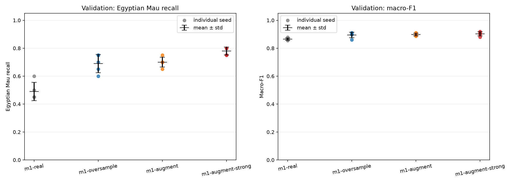
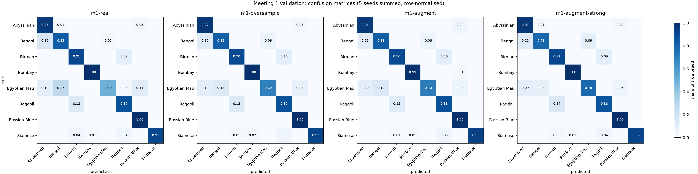
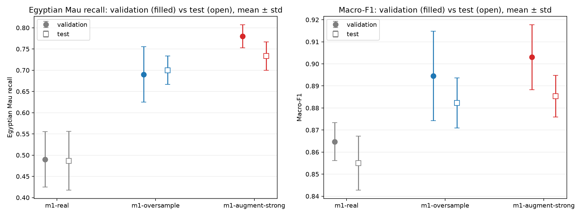

# Experiment Log

Keep one section per meeting. Add the tables and plots you make from
`runs/*/results.json` and `test-results.json` (save the plots in `evidence/`),
link the pools' contact sheets, and explain what you see. A result that shows no
effect is still a result: say so and say why.

## Meeting 0 — Exploration and predictions

- **What this was:** an exercise before any training or generation: look at
  the data and the tools, then write down what I expect each meeting to show.
  These are guesses made in advance, to be checked against the real results
  later. Details in `notebooks/meeting0.ipynb`.
- **What the data shows:**
  - Egyptian Mau has 15 training photos against 70 for every other breed; the
    validation and test photos are balanced (20 and 30 per breed).
  - In the frozen ImageNet backbone, Egyptian Mau's closest breed by far is
    Bengal (cosine 0.858); Abyssinian (0.586) and Russian Blue (0.530) are much
    further away.
  - Without any training, a nearest-centroid classifier already finds 0.85 of
    the validation Maus; 1-NN, which feels the imbalance, finds 0.75.
  - 13 of the 15 training Maus are silver, side-on, whole-cat photos, often on
    studio backdrops. Validation and test also contain close-ups, bronze cats
    and cats lying or curled up. Three validation Maus (#155, #15, #148) are
    closer to another breed than to Egyptian Mau before training.
- **What I expect from each meeting:**
  - **Meeting 1 (oversample, augment):** the imbalanced baseline will be poor
    (Mau recall about 0.6 or below, errors mostly to Bengal). Oversampling will
    fix most of it, because the main problem is the class prior. Augmentation
    will add little, because every training image is already cropped, flipped
    and re-lit. The hard photos will stay hard.
  - **Meeting 2 (text-to-image):** the riskiest method. The model may draw a
    generic spotted cat instead of a Mau, which could push Bengals to "Mau"
    without helping the real Maus. I expect at best a small gain over
    oversampling.
  - **Meeting 3 (img2img, IP-Adapter):** safer, because the images start from
    real Maus. Low img2img strength will behave like oversampling; higher
    strength and IP-Adapter can add new poses, which is what the hard photos
    need.
  - **Meeting 4 (inpainting, outpainting):** new backgrounds will help less than
    new cats, because the hard Maus are hard because of the cat's view and
    coat, not the scene. Outpainting may help with distant, small cats.
  - **Final comparison:** balancing will give the largest single gain; synthetic
    data, if it helps at all, will add a few points on top.
- **Conclusion:** the first problem is the class prior, not the look of the
  breed. The second is missing views of the cat. Synthetic data is worth using
  only if it adds those views without costing Bengal recall, so Bengal recall
  is the number to watch in every meeting.

## Meeting 1 — Real-data baselines

- **Question:** How much do oversampling and ordinary augmentation help Egyptian
  Mau recall compared with the imbalanced data?
- **How `oversample()` works:** repeats the 15 Mau training photos as evenly as
  possible to add 55 examples: 55 = 3·15 + 10, so every photo is added 3 times
  and 10 of them a 4th time, chosen with the seeded `rng`. The copies are
  identical; only the class frequency changes.
- **How `augment()` works, and why these transforms:** the 55 copies are
  re-transformed every time they are loaded, so each epoch sees new variants.
  Two recipes, chosen with `SYNTHDATA_AUGMENT`:
  - **mild** (`m1-augment`): flip, rotation ±15°, shift ±10%, zoom 0.9–1.1×,
    brightness/contrast ±20%, saturation ±15%. Changes a real photo of the same
    cat could have; hue is untouched because coat colour is a breed cue.
  - **strong** (`m1-augment-strong`): rotation ±35°, shift ±20%, zoom 0.7–1.3×,
    jitter ±40%, hue ±0.1, grayscale (p 0.2), blur (p 0.3). Written to test the
    hypothesis that damaging the coat colour and pattern would give **no gain or
    a loss**.
- **Commands:** trained on a Colab T4 with `colab/m1_train.ipynb`, 5 seeds each:

  ```bash
  uv run synth-train --name m1-real --method real
  uv run synth-train --name m1-oversample --method oversample
  uv run synth-train --name m1-augment --method augment --tag augment=mild
  SYNTHDATA_AUGMENT=strong uv run synth-train --name m1-augment-strong \
      --method augment --tag augment=strong
  uv run synth-test --run m1-real    # and m1-oversample, m1-augment-strong
  ```

- **Results on validation:** (20 Maus per run; one photo = 0.05 recall)

  | Run | Mau recall (mean ± std) | Macro-F1 |
  | --- | ---: | ---: |
  | `m1-real` | 0.49 ± 0.07 | 0.865 |
  | `m1-oversample` | 0.69 ± 0.07 | 0.894 |
  | `m1-augment` (mild) | 0.70 ± 0.04 | 0.897 |
  | `m1-augment-strong` | **0.78 ± 0.03** | **0.903** |

  
  
- **What I see:**
  - Balancing is the big step: +0.20 to +0.29 recall, better on every seed
    (p = 0.0625, the minimum with 5 seeds). The baseline avoids the answer
    "Mau" (precision 0.96, recall 0.49): a class-prior problem.
  - Mild augmentation adds nothing over oversampling, because `TRAIN_TRANSFORM`
    already crops, flips and re-lights every image.
  - Strong augmentation beat mild on all 5 seeds (+0.08). **My hypothesis was
    refuted.** Likely reasons: the 15 originals stay undistorted, so the real
    colour is still learned; harsh copies stop the model memorizing the 15
    photos and push it towards spots and shape (Maus called Russian Blue fall
    11 → 5).
  - Cost: more Bengals called "Mau" (2 → 9 of 100); Bengal recall 0.83 → 0.79.
  - 3 validation Maus (#15, #155, #131) are missed by all 20 models: views the
    15 training photos don't have (distant, bronze portrait, curled up).
  - **Chosen for test:** `m1-augment-strong` (highest recall and macro-F1),
    written down before testing.
- **Test results of the three baselines:** (30 Maus per run; one photo = 0.033)

  | Run | Mau recall val → test | Macro-F1 val → test |
  | --- | ---: | ---: |
  | `m1-real` | 0.49 → **0.49 ± 0.07** | 0.865 → **0.855** |
  | `m1-oversample` | 0.69 → **0.70 ± 0.03** | 0.894 → **0.882** |
  | `m1-augment-strong` | 0.78 → **0.73 ± 0.03** | 0.903 → **0.885** |

  

  The ranking holds and balancing is confirmed (+0.21 and +0.25 on every seed).
  Strong's lead over oversampling shrinks from +0.09 to +0.03 (p = 0.375):
  part of its validation gain was luck on the 20 photos it was chosen on.
  7 of the 30 test Maus are missed by every model, a ceiling of 0.77.
  **Bar for synthetic data: 0.73 Mau recall at 0.885 macro-F1 on test.**
  Full analysis: `notebooks/meeting1.ipynb`.

## Meeting 2 — Text-to-image generation

- **Question:**
- **Setting changed in each pool (one at a time):**
- **Commands:**
- **Contact sheets:** (good and bad images, with the failure types you name)
- **Results on validation:** (table and plot)
- **What I see:**
- **Pool I take forward, and why:**
- **Its test result, compared with the baselines:**

## Meeting 3 — Generation from training photos

- **Question:** How close to the real photos should the synthetic images be?
- **img2img strength values and IP-Adapter scale values tried:**
- **Commands:**
- **Contact sheets:**
- **Results on validation:**
- **What I see:**
- **Best run of each mode, and its test result:**

## Meeting 4 — Editing training photos

- **Question:** Does the classifier need new cats or new backgrounds?
- **Background prompts and outpainting scales tried:**
- **Commands:**
- **Contact sheets:**
- **Results on validation:**
- **What I see:**
- **Best run of each mode, and its test result:**

## Final comparison

- **Runs chosen in Meetings 1–4:**
- **Results:** (your table and plot of their `test-results.json`)
- **Did the validation ranking hold on the test photos?**
- **Recommendation:** use, revise, or reject synthetic data for this task.
